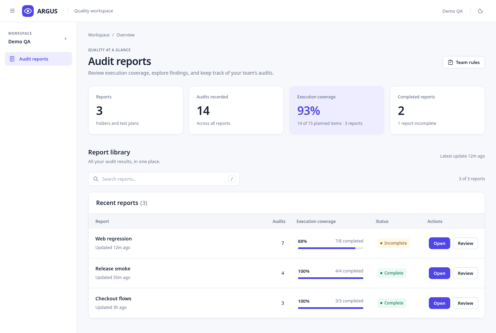

# ARGUS

**Evidence-based QA auditing for Jira and Zephyr.**

[](https://github.com/ivinitus/ARGUS/actions/workflows/ci.yml)

ARGUS downloads test executions and their evidence, applies deterministic QA
rules and model-assisted image analysis, and turns the results into reports you
can investigate and review. It is a Python CLI with a local web interface.



*The screenshot uses synthetic demo reports. No real project data is included.*

## What you can do

| Capability | What it provides |
| --- | --- |
| Audit executions | Audit an execution, folder, or test plan against configurable QA policies. |
| Inspect evidence | Analyze screenshots and PDF pages, with optional local video decoding and sampled-frame analysis. |
| Explore reports | Search reports, filter runs and execution dates, inspect findings and coverage, export CSV, and retain JSON/Markdown audit results. |
| Review findings | Assign reviewers, record decisions and reasons, and retain review history and evidence snapshots. |
| Manage rules | Edit rules and policies, test drafts against saved executions, and publish versioned changes. |
| Work locally | Use a responsive dashboard with light/dark themes, local files, and SQLite state. |

Automated verdicts are **Compliant**, **Concerns**, or **Deviation**. Incomplete
analysis is reported separately. Human review records a decision without
rewriting the automated verdict or changing Jira.

## Quick start

### 1. Install

Requires **Python 3.11+**. These commands install from source:

```bash
git clone https://github.com/ivinitus/ARGUS.git
cd ARGUS
python -m venv .venv
source .venv/bin/activate
python -m pip install -e ".[video]"
cp config.example.toml config.toml
```

The optional `video` extra installs PyAV for local video/audio decoding. Use
`python -m pip install -e .` if you only need screenshots and PDFs. Audio
transcription requires a separately configured provider; see
[video and audio](docs/video-audio-audit.md).

### 2. Configure connections

Edit `config.toml`:

- Set `extractor.base_url` and `extractor.project_id` for your Jira installation.
- Check the models under `[auditor]` and choose IDs available from your provider.
- Adjust the example profile and policies for your test environment.

The connector expects **Jira-hosted Zephyr REST endpoints under `/rest/atm/1.0`**.
Other Zephyr Cloud API variants need a compatible connector.

Set credentials in your shell. The following **Bash** prompts keep the entered
values out of shell history:

```bash
read -rs -p "Jira PAT: " ARGUS_JIRA_PAT; export ARGUS_JIRA_PAT; echo
read -rs -p "Model API key: " ARGUS_MODEL_API_KEY; export ARGUS_MODEL_API_KEY; echo
argus config validate
```

`argus config validate` checks settings; it does not authenticate either
connection. The default model endpoint uses the public Anthropic Messages API,
and `ANTHROPIC_API_KEY` is also accepted. Endpoint URLs and credential variable
names are configurable.

### 3. Audit and open the dashboard

Choose an execution, folder, or test plan from your installation:

```bash
argus audit --key QA-E123
argus audit --folder "Release regression"
argus audit --test-plan QA-P123
```

After an audit, open the saved reports locally:

```bash
argus serve
```

Visit **http://127.0.0.1:2405/**. Use **Open** to inspect a report, **Review** to
review its executions, or **Team rules** to manage policies. Stop the local
server with `Ctrl+C`.

To regenerate the HTML report for the folder example:

```bash
argus report --out-dir output/Release_regression --html
```

Existing reports can be viewed and regenerated without model requests. The
server needs an existing output directory; an audit creates it. Folder, run,
and plan targets retain their own evidence scope, and re-auditing an execution
updates its result rather than duplicating it.

## Human review and rules

The local app uses the process owner's username. To review as your Jira user,
set the name before starting the server:

```bash
export ARGUS_OPERATOR_NAME="your-jira-username"
argus serve
```

Reviewer allocation validates active Jira usernames and prevents self-review.
Reviewers can inspect evidence, confirm or reject findings, request
investigation, and save progress. See [human review](docs/human-review.md).

Team rules supports draft editing, tests against saved evidence, publication,
and version history. Publishing requires a successful test of the exact draft;
later audits use the published policy. See [team rules](docs/team-rules.md).

## Profiles and maintenance

```bash
argus config profiles
argus --profile mobile audit --folder "Mobile regression"
argus costs
argus prune                 # preview evidence eligible for cleanup
argus prune --apply         # remove eligible evidence, retain audits/metadata
```

Profiles (`web`, `desktop`, `tablet`, `mobile`, `reader`, `tv`, `portal`) are
configurable examples. Use them to define hosts, status names, device policies,
and evidence requirements for your own environment. Cost reporting uses
configured provider rates; unpriced usage is labeled rather than assigned an
assumed price.

## Data and operating limits

- **Local application:** the server binds to localhost and uses a local actor.
  Shared hosting needs a separate authentication layer.
- **Provider requests:** selected evidence is sent to your configured model
  provider during analysis. Model access may incur charges.
- **Saved state:** reports and evidence use `extractor.out_dir`; review records,
  rules, and control state use `general.state_dir` (default `~/.argus`).
  Preserve these directories when upgrading.
- **Media limits:** video analysis samples frames rather than inspecting every
  instant. Missing required evidence or unsupported analysis is surfaced
  explicitly.
- **Secrets and evidence:** keep credentials, local configuration, and generated
  project data out of Git. No corporate login or private package index is needed.

## Project layout

```text
src/argus/
  cli/          Command-line entry points
  config/       Typed settings and validation
  domain/       QA rules and finding identity
  pipeline/     Extraction, evidence processing, and model analysis
  operations/   Local state, review, rules, and notifications
  reporting/    Reports, web interface, and local server
tests/          Python and JavaScript regression tests
docs/           Setup and feature guides
```

Read the [architecture guide](docs/architecture.md) for the boundaries between
extraction, analysis, and reporting.

## Development

From an activated virtual environment:

```bash
python -m pip install -e ".[dev,video,browser]"
python -m playwright install chromium
pytest -q
ruff check .
node --test tests/js/*.test.cjs tests/operator-controls.test.mjs
python -m build
python tools/check_public_tree.py --archives dist
```

JavaScript tests require Node.js; CI uses Node.js 22. GitHub Actions runs the
Python suite on 3.11, 3.12, and 3.13, plus lint, browser and JavaScript tests,
distribution builds, and public-content checks. External clients are replaced
in tests; real Jira or model credentials are not required.

See [Contributing](CONTRIBUTING.md) for the test workflow.

## Documentation

- [Getting started](docs/getting-started.md)
- [Configuration](docs/configuration.md)
- [Audit rules](docs/rules.md) and [accuracy behavior](docs/audit-accuracy.md)
- [Human review](docs/human-review.md) and [team rules](docs/team-rules.md)
- [Video and audio](docs/video-audio-audit.md)
- [Public migration notes](docs/public-migration.md)

## License

The project code is provided under the [MIT license](LICENSE).
Installed third-party dependencies retain their own licenses.
